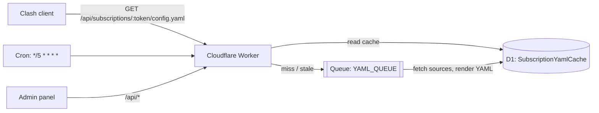

# Oh My Proxy

> Self-hosted Clash / Mihomo subscription converter and manager running on **Cloudflare Workers + D1 + Queues** — no server, no managed database, and it fits in the free tier.

[](LICENSE)
[](https://developers.cloudflare.com/workers/)
[](https://nextjs.org/)
[](https://www.typescriptlang.org/)

- Chinese README: [README.md](README.md)
- Deployment: [docs/CLOUDFLARE_DEPLOY.md](docs/CLOUDFLARE_DEPLOY.md) (Chinese) / [English](docs/CLOUDFLARE_DEPLOY.en.md)
- Contributing: [docs/CONTRIBUTING.md](docs/CONTRIBUTING.md) · Third-party notices: [docs/THIRD_PARTY_NOTICES.md](docs/THIRD_PARTY_NOTICES.md)

## Contents

- [What it does](#what-it-does)
- [Features](#features)
- [Architecture](#architecture)
- [Deploy your own instance](#deploy-your-own-instance)
- [Local development](#local-development)
- [Project layout](#project-layout)
- [Configuration](#configuration)
- [Subscription cache behaviour](#subscription-cache-behaviour)
- [HTTP API](#http-api)
- [Limits](#limits)
- [FAQ](#faq)
- [Security](#security)
- [Contributing](#contributing)
- [Changes relative to the upstream project](#changes-relative-to-the-upstream-project)
- [License and origin](#license-and-origin)
- [Disclaimer](#disclaimer)

## What it does

Feed it airport or self-hosted subscription URLs, and it gives you back **one stable subscription URL**. Clients (Clash Verge, Mihomo, FlClash, Stash, …) subscribe to that single URL and receive a full YAML config with your own proxy groups, rules and DNS settings.

Typical flow:

1. Import sources — airport subscription URLs, Clash YAML, or single node links.
2. Pick a template in the web UI, toggle group modules, configure region groups, filters, custom groups and rules.
3. Copy the subscription URL into your client.
4. From then on, change nodes, groups or rules server-side only; the client just refreshes the subscription.

## Features

**Conversion**

- Imports Clash / Mihomo YAML, base64 node lists and single node links (ss, vmess, vless, trojan, hysteria2, tuic)
- Up to 10 sources per subscription; nodes keep source order, duplicates are renamed deterministically
- Emits standard Clash/Mihomo YAML with `subscription-userinfo` (traffic, expiry) headers
- Traffic fallback: when a source only reports remaining quota, totals are inferred instead of showing 0
- Node names keep the provider's original text, including `[63ms 21.18Mbps]` speed snapshots; cross-source duplicates get a `(2)` suffix

**Groups and rules**

- 14 built-in group modules (select, auto, ads, private, China, non-China, AI, YouTube, Google, Microsoft, Apple, GitHub, Telegram, final), each toggleable
- Advanced per-group filters evaluated in order: sources → regions → include regex → exclude regex
- Region groups matched by node-name keywords, with configurable group type (select / url-test / fallback) and test parameters
- Custom groups and custom rules (DOMAIN, DOMAIN-SUFFIX, DOMAIN-KEYWORD, IP-CIDR, PROCESS-NAME, RULE-SET, …) pointing at any group
- Rule providers with configurable base URL (swap GitHub raw for a jsDelivr mirror), refresh interval and proxy group
- Chain proxies (dialer-proxy) and group listeners

**Operations**

- Single administrator with optional TOTP; first-run setup via a one-time token, no public sign-up
- Asynchronous YAML generation: D1 cache + Queues, cron refresh every 5 minutes, manual refresh, retry and recovery
- Responsive Chinese UI (desktop and mobile), light and dark themes

## Architecture



- Worker (`local/cloudflare/worker.ts`): routing, auth, subscription endpoints, static assets, queue consumer, cron entry.
- D1: all business data plus the YAML cache; migrations live in `local/cloudflare/migrations/`.
- Queues: YAML rendering, source import and manual refresh run off the request path.
- Generation logic is pure and lives in `packages/core`; `packages/server-core` handles fetching and traffic info, `packages/ui` the React components, `local` the Next.js 16 App Router app on top of vinext.

## Deploy your own instance

Requirements: a Cloudflare account with Workers / D1 / Queues, Node.js `>=22.13.0 <23 || >=24.0.0`, Git, and `npx wrangler login`.

```bash
git clone https://github.com/wahaha1024/oh-my-proxy.git
cd oh-my-proxy
npm ci

npx wrangler d1 create oh-my-proxy
npx wrangler queues create oh-my-proxy-jobs

cp local/wrangler.example.jsonc local/wrangler.production.jsonc
# set name / database_name / database_id / queue names to your own values
cd local
node scripts/create-cloudflare-secrets.mjs production https://sub.example.com
npm run build:vinext
npx wrangler d1 migrations apply oh-my-proxy --remote --config wrangler.production.jsonc
npx wrangler deploy --config wrangler.production.jsonc --secrets-file .production-secrets
```

Then open `https://sub.example.com/login#setup-token=<LOCAL_SETUP_TOKEN>` to create the administrator (password at least 10 characters). The token is single-use.

Always build with `npm run build:vinext` (vinext). `npm run build` (`next build`) does not produce `dist/client` and deployment fails with `The directory specified by the "assets.directory" field does not exist`.

### Custom domain

Add a route to `local/wrangler.production.jsonc` and redeploy:

```jsonc
{ "routes": [{ "pattern": "sub.example.com", "custom_domain": true }] }
```

Then update the `APP_URL` secret to that origin and deploy again — subscription URLs are built from `APP_URL`. Once a custom domain is bound, `*.workers.dev` returns 404 by design.

### Secrets

`JWT_SECRET` (session signing), `AUTH_PEPPER` (password hashing), `ENCRYPTION_KEY` (encrypted columns), `LOCAL_SETUP_TOKEN` (one-time admin setup), `APP_URL` (public origin). Keep `local/.production-secrets` offline and never commit it.

Build-time variable `NEXT_PUBLIC_SOURCE_REPOSITORY_URL` points the footer "source (AGPL)" link at your own repository — required when you deploy a modified version.

## Local development

```bash
npm ci
npm --prefix local run dev:vinext   # vinext dev server (Cloudflare path)
npm --prefix local run dev          # Next.js dev server (needs PostgreSQL / Prisma)
npm run lint
npm --prefix local run typecheck
npm run test:unit
npm run test:core
```

## Project layout

```text
.
├── local/                      # Next.js 16 app + Cloudflare adapter
│   ├── app/                    # App Router routes ((site) group = pages, api/ = endpoints)
│   ├── src/                    # client components, stores, request helpers
│   ├── cloudflare/             # worker entry, D1 migrations, repositories, queues, rate limiting
│   ├── scripts/                # secret generation, smoke tests, build helpers
│   └── wrangler.example.jsonc  # deployment config template
├── packages/
│   ├── core/                   # pure logic: parsing, rendering, rules, groups, node names
│   ├── server-core/            # shared server logic: fetching, traffic info, snapshots
│   ├── ui/                     # React components and converter UI
│   └── config/
├── docs/                       # deployment guides, contributing, third-party notices
├── scripts/ test/              # repo-level scripts and cross-package tests
└── NOTICE.md / LICENSE
```

## Configuration

### Secrets

| Name | Purpose |
| --- | --- |
| `JWT_SECRET` | Session JWT signing |
| `AUTH_PEPPER` | Global pepper for password hashes |
| `ENCRYPTION_KEY` | Encrypts sensitive source fields |
| `LOCAL_SETUP_TOKEN` | One-time admin setup token (`/login#setup-token=…`) |
| `APP_URL` | Public origin; drives subscription URLs |

### Per-subscription keys

| Key | Purpose |
| --- | --- |
| `ruleProviderBaseUrl` | Rule-set base URL; default GitHub raw, swap to jsDelivr when blocked |
| `ruleProviderInterval` | Rule-set refresh interval in seconds (≥60, default 86400) |
| `ruleProviderProxy` | Proxy group used to fetch rule sets |
| `dnsYaml` | Full DNS block; replaces the default one |
| `nodeNameFilter` | Exclude regex for node names (filters out ad pseudo-nodes) |
| `proxyGroupAdvanced` | Per-group filters: `sourceIds` / `regions` / `includeRegex` / `excludeRegex` / `groupType` / `strategy` |
| `customProxyGroups` / `customRules` | Custom groups and rules |

## Subscription cache behaviour

YAML is generated asynchronously and cached in D1 (table `SubscriptionYamlCache`), keyed on the subscription's `updatedAt`. Saving a subscription invalidates the cache; changing generator code requires saving a subscription once before the new output appears. Responses are `cache-control: no-store`, but edges may still serve the previous version briefly — append `?ts=<timestamp>` while debugging. Only Clash-family user agents receive `Subscription-Userinfo` from some providers; a source can set `userinfoUserAgent` explicitly.

## HTTP API

| Method and path | Purpose |
| --- | --- |
| `GET /api/health/live` | Liveness probe |
| `GET /api/health/ready` | Readiness probe (includes D1 connectivity) |
| `POST /api/auth/login` | Admin login (password + optional TOTP) |
| `GET /api/auth/me` | Current session and setup state |
| `POST /api/setup/admin` | Create the administrator with the one-time token (`X-SubBoost-Setup-Token`) |
| `GET/POST /api/subscriptions` | List / create subscriptions |
| `GET/PUT/DELETE /api/subscriptions/:id` | Detail / full config overwrite / delete |
| `GET /api/subscriptions/:token/config.yaml` | Client subscription endpoint, returns YAML |
| `GET /api/releases/latest` | Version check (proxies GitHub Releases) |

## Limits

200 nodes per subscription, 20 subscriptions per instance, 10 sources per subscription. These are built-in anti-abuse caps; excess is truncated during import or generation.

## FAQ

**`assets.directory` does not exist on deploy.** You used `next build`. Use `npm --prefix local run build:vinext`.

**`wrangler deploy` fails with `fetch failed` or proxy errors.** Unset `HTTPS_PROXY HTTP_PROXY ALL_PROXY` and deploy directly; Cloudflare's API is often broken by a local TLS-intercepting proxy.

**`*.workers.dev` returns 404 after deploy.** Binding a custom domain disables the preview hostname by design.

**Saved config not reflected in the subscription.** See [cache behaviour](#subscription-cache-behaviour): wait for one queue pass, or fetch with `?ts=`.

**No traffic info, or it shows 0.** Some providers only return `Subscription-Userinfo` for Clash-family user agents. Set `userinfoUserAgent` on the source, or keep a text info node so the server can parse the remaining quota.

**Rule sets keep failing.** Switch `ruleProviderBaseUrl` to the jsDelivr mirror and point `ruleProviderProxy` at a working `url-test` group.

**Validate a generated config.** `mihomo -t -d /tmp/test -f your-config.yaml` prints `configuration file test is successful` when the syntax is valid.

## Security

Passwords are bcrypt-hashed with a global pepper, sessions use signed JWTs, sensitive source fields are encrypted with `ENCRYPTION_KEY`. There is a single administrator account and no public sign-up; setup relies on a one-time token. Use a long random password, enable TOTP, and consider Cloudflare Access in front of the panel. Never commit `.production-secrets` or `wrangler.production.jsonc`.

## Contributing

Issues and pull requests are welcome. See [docs/CONTRIBUTING.md](docs/CONTRIBUTING.md): one concern per PR, no secrets or personal config, no version bumps, keep both READMEs in sync.

## Changes relative to the upstream project

This project reworks the deployment shape, the generation path and the UI on top of the upstream codebase.

**Deployment**

- Runtime moved from a Node server to Cloudflare Workers, PostgreSQL to D1 (SQLite), background jobs to Queues + Cron, static assets to Workers Assets.
- New vinext build chain and a `local/cloudflare/` adapter layer: routing, auth, D1 repositories, queue delivery, rate limiting, cron sweeps.
- A script generates the instance secrets and the one-time admin token (`local/scripts/create-cloudflare-secrets.mjs`); `wrangler.example.jsonc` is the deployment template.

**Accounts and security**

- Single-administrator model with no public sign-up; setup uses a one-time token that expires after use; optional TOTP.
- Passwords are bcrypt-hashed with a global pepper, sessions use signed JWTs, sensitive source fields are encrypted with `ENCRYPTION_KEY`.

**Generation**

- YAML is rendered asynchronously and cached in D1 (`SubscriptionYamlCache`), invalidated by the subscription's `updatedAt`; cron sweeps every 5 minutes; requests never fetch sources synchronously.
- Nodes keep strict source order; cross-source duplicates are renamed deterministically instead of depending on fetch completion order.
- Node names keep the provider's original speed snapshots (e.g. `[63ms 21.18Mbps]`).
- Traffic info prefers `Subscription-Userinfo`; when a source only reports remaining quota, totals are inferred; duplicate info from the same source is no longer summed.
- Rule-provider base URL, refresh interval and the proxy group used for fetching are configurable.
- Added source-import fallback and per-source UA control (`userinfoUserAgent`).

**UI**

- Config generator (templates, region groups, regex filters, custom groups and rules), subscription management, template library, login page.
- Editing a custom group no longer displaces the node editor; the login form renders on first paint.
- Responsive Chinese UI with light and dark themes; redesigned warm cream palette and icon set.

**Docs**

- Rewritten Chinese and English READMEs, plus the Cloudflare deployment guide, configuration reference, cache behaviour, API summary, FAQ and security notes.

## License and origin

Distributed under [GNU AGPL-3.0-only](LICENSE).

The implementation references and derives from [SubBoost/subboost](https://github.com/SubBoost/subboost) (AGPL-3.0). The full origin, change and third-party notices are in [NOTICE.md](NOTICE.md) and [docs/THIRD_PARTY_NOTICES.md](docs/THIRD_PARTY_NOTICES.md); original copyright notices and the license text must be preserved. Under AGPL you must offer the source of the version you actually run — the footer "source (AGPL)" link is that entry point; set `NEXT_PUBLIC_SOURCE_REPOSITORY_URL` to your own repository.

## Disclaimer

This project only converts and manages subscription formats. It ships **no nodes, no airport service and no credentials**. You are responsible for your sources and for complying with local laws and your providers' terms.
